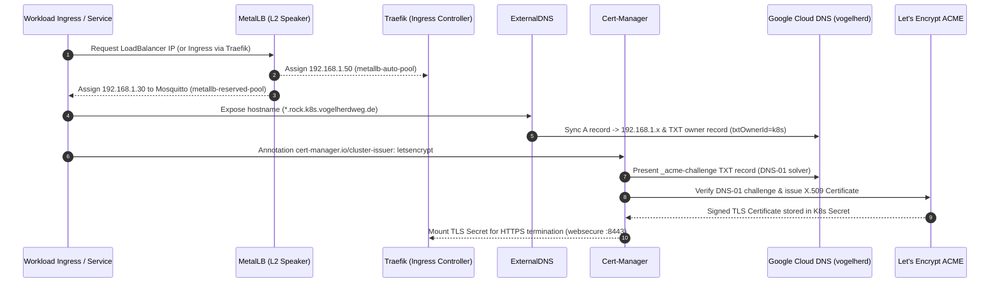
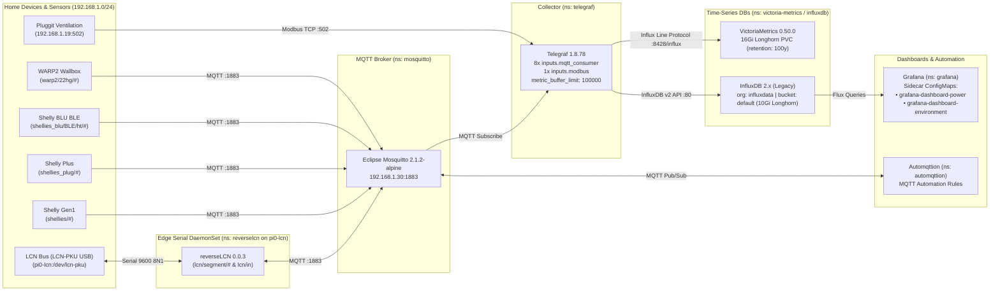

# Sloth System Architecture

This document illustrates the GitOps application hierarchy, network/ingress flow, distributed block storage topology, and smarthome telemetry pipeline of the `sloth` cluster.

---

## 1. Argo CD App-of-Apps Hierarchy

`sloth` uses a 3-tier Argo CD **App-of-Apps** structure rooted in [`argocd-base/`](../argocd-base/). Every `Application` reconciles against `HEAD` of `git@github.com:MyChaOS87/sloth.git` with automated `syncPolicy` (`prune: true`, `selfHeal: true`).

```mermaid
flowchart TD
    subgraph Tier0["Tier 0: Bootstrap (argocd-base/)"]
        ArgoCD["argocd (argo-cd 10.14.0)<br/>ns: argocd"]
        Nodes["nodes (ServerSideApply)<br/>path: nodes/ | proj: nodes"]
        RootEssentials["argocd-cluster-essentials<br/>path: cluster-essentials/"]
        RootDeployments["argocd-deployments<br/>path: deployments/"]
    end

    subgraph Tier1["Tier 1: Cluster Essentials (cluster-essentials/)"]
        SealedSecrets["sealed-secrets (2.22.0)<br/>ns: kube-system"]
        KubeVIP["kube-vip (0.11.2)<br/>ns: kube-system | VIP: 192.168.1.20"]
        MetalLB["metallb (0.16.2) + metallb-config<br/>ns: metallb"]
        Traefik["traefik (42.3.1) + dashboard<br/>ns: traefik"]
        CertManager["cert-manager (v1.21.3) + cluster-issuer<br/>ns: cert-manager"]
        ExternalDNS["external-dns (1.23.0) + external-dns-config<br/>ns: external-dns"]
        Longhorn["longhorn (1.13.0) + storage-nodes<br/>ns: longhorn"]
        SysUpgrade["system-upgrade (v0.21.0)<br/>ns: system-upgrade"]
        Prometheus["prometheus (29.41.0)<br/>ns: prometheus"]
        VersionChecker["version-checker (v0.11.0)<br/>ns: version-checker"]
    end

    subgraph Tier2["Tier 2: Workload Projects (deployments/)"]
        AppOIDC["oidc<br/>path: deployments/oidc/"]
        AppSmarthome["smarthome<br/>path: deployments/smarthome/"]
    end

    subgraph Tier3_OIDC["OIDC Stack (deployments/oidc/)"]
        Keycloak["keycloak (keycloakx 7.4.0)<br/>ns: keycloak"]
    end

    subgraph Tier3_SH["Smarthome Stack (deployments/smarthome/)"]
        Mosquitto["mosquitto (local chart 2.1.2)<br/>ns: mosquitto"]
        Telegraf["telegraf (1.8.78)<br/>ns: telegraf"]
        VictoriaMetrics["victoria-metrics (0.50.0)<br/>ns: victoria-metrics"]
        InfluxDB["influxdb (influxdb2 2.1.2)<br/>ns: influxdb"]
        Grafana["grafana (10.5.15) + dashboards<br/>ns: grafana"]
        Automqttion["automqttion (0.0.5)<br/>ns: automqttion"]
        ReverseLCN["reverselcn (0.0.3)<br/>ns: reverselcn"]
    end

    RootEssentials --> SealedSecrets
    RootEssentials --> KubeVIP
    RootEssentials --> MetalLB
    RootEssentials --> Traefik
    RootEssentials --> CertManager
    RootEssentials --> ExternalDNS
    RootEssentials --> Longhorn
    RootEssentials --> SysUpgrade
    RootEssentials --> Prometheus
    RootEssentials --> VersionChecker

    RootDeployments --> AppOIDC
    RootDeployments --> AppSmarthome
    AppOIDC --> Keycloak
    AppSmarthome --> Mosquitto
    AppSmarthome --> Telegraf
    AppSmarthome --> VictoriaMetrics
    AppSmarthome --> InfluxDB
    AppSmarthome --> Grafana
    AppSmarthome --> Automqttion
    AppSmarthome --> ReverseLCN
```

### AppProject Isolation Boundaries

| `AppProject` | Manifest | Permitted Source Repos | Target Namespaces |
|--------------|----------|------------------------|-------------------|
| `argocd-base` | [`argocd-base/argocd-base.yaml`](../argocd-base/argocd-base.yaml) | `*` | `argocd` |
| `nodes` | [`argocd-base/nodes.yaml`](../argocd-base/nodes.yaml) | `git@github.com:MyChaOS87/sloth.git` | Cluster-scoped `v1/Node` only (`namespaceResourceBlacklist: */*`, no orphan watch) |
| `cluster-essentials` | [`cluster-essentials/cluster-essentials.yaml`](../cluster-essentials/cluster-essentials.yaml) | `*` | `*` (cluster-wide infrastructure & CRDs) |
| `oidc` | [`deployments/oidc/oidc.yaml`](../deployments/oidc/oidc.yaml) | `*` | `*` (`keycloak`) |
| `smarthome` | [`deployments/smarthome/smarthome.yaml`](../deployments/smarthome/smarthome.yaml) | `*` | `*` (`mosquitto`, `telegraf`, `victoria-metrics`, `influxdb`, `grafana`, `automqttion`, `reverselcn`) |

---

## 2. Networking, Ingress, DNS & TLS Architecture

Because K3s runs with `--disable traefik --disable servicelb`, Layer-2 IP allocation, ingress routing, public DNS records, and Let's Encrypt TLS certificates are orchestrated through four collaborating components:

### Exposed Endpoints Summary

| Service | Hostname / IP | Exposure Mechanism | TLS / Auth |
|---------|---------------|--------------------|------------|
| **K3s Control-Plane API** | `192.168.1.20:6443` (`api.internal.k8s.vogelherdweg.de`, `api.rock.k8s.vogelherdweg.de`) | `kube-vip` L2 ARP Leader Lease (`plndr-cp-lock` on `enP4p65s0`) + `ExternalName` DNS Service | K3s Cluster CA TLS (`:6443`) |
| **Argo CD UI/API** | `argocd.rock.k8s.vogelherdweg.de` | Traefik `Ingress` | Let's Encrypt TLS + Keycloak OIDC |
| **Traefik Dashboard** | `traefik.rock.k8s.vogelherdweg.de` | Traefik `IngressRoute` | HTTP / Internal LAN |
| **Longhorn UI** | `longhorn.rock.k8s.vogelherdweg.de` | Traefik `Ingress` | Let's Encrypt TLS |
| **Prometheus UI** | `prometheus.rock.k8s.vogelherdweg.de` | Traefik `Ingress` | Let's Encrypt TLS |
| **Keycloak SSO** | `keycloak.rock.k8s.vogelherdweg.de` | Traefik `Ingress` | Let's Encrypt TLS |
| **Grafana** | `grafana.rock.k8s.vogelherdweg.de` | Traefik `Ingress` | Let's Encrypt TLS + Keycloak OIDC |
| **VictoriaMetrics UI/API** | `victoria.rock.k8s.vogelherdweg.de`, `victoria.internal.k8s.vogelherdweg.de` | Traefik `Ingress` | Let's Encrypt TLS |
| **InfluxDB UI/API** | `influx.rock.k8s.vogelherdweg.de` | Traefik `Ingress` | Let's Encrypt TLS |
| **Mosquitto MQTT** | `192.168.1.30:1883` (`mqtt.rock.k8s.vogelherdweg.de`, `mqtt.internal.k8s.vogelherdweg.de`) | MetalLB `LoadBalancer` (`metallb-reserved-pool`) | TCP `:1883` |

---

## 3. Declarative Node Roles & Rolling Upgrade Architecture

`sloth` separates node capabilities into explicit single-purpose roles managed via Server-Side Apply ([`argocd-base/nodes.yaml`](../argocd-base/nodes.yaml), `AppProject: nodes`, `sync-wave: "-1"`, `Prune=false,Delete=false`):

| Role Label | Assigned Nodes | Consuming DaemonSet / Component | Taint Handling |
|------------|----------------|---------------------------------|----------------|
| `node-role.kubernetes.io/storage: "true"` | `rock5b-but`, `rock5b-first`, `rock5b-coffee` | [`longhorn`](../cluster-essentials/longhorn.yaml) (`longhornManager`, `longhornDriver`) | Untainted control-plane/storage nodes |
| `node-role.kubernetes.io/speaker: "true"` | `rock5b-but`, `rock5b-first`, `rock5b-coffee` | [`metallb`](../cluster-essentials/metallb.yaml) (`speaker.nodeSelector`) | Untainted wired LAN nodes |
| `node-role.kubernetes.io/monitoring: "true"` | `rock5b-but`, `rock5b-first`, `rock5b-coffee`, `pi0-lcn` | [`prometheus`](../cluster-essentials/prometheus.yaml) (`prometheus-node-exporter.nodeSelector`) | Tolerates `effect: NoSchedule` and `key: dedicated` (`operator: Exists`) |
| `node-role.kubernetes.io/lcn-serial: "true"` | `pi0-lcn` (tainted `dedicated=lcn-serial:NoExecute`) | [`reverselcn`](../deployments/smarthome/reverselcn.yaml) (`DaemonSet`, `maxSurge: 0`, `maxUnavailable: 1`) | Tolerates `dedicated=lcn-serial:NoExecute` |

- **Two-Phase `v1/Node` Registration**:
  - Applying a `v1/Node` manifest via `ServerSideApply=true` before a physical node has joined creates a bare `NotReady` node in Kubernetes and bypasses kubelet's initial cloud-provider registration taint. Only nodes that have already joined the cluster are declared in [`nodes/`](../nodes/), and each `v1/Node` manifest carries `argocd.argoproj.io/sync-options: Prune=false,Delete=false` so even a cascade delete of the `nodes` Application can never delete a live node.
- **Rolling K3s Upgrades ([`cluster-essentials/system-upgrade-config/`](../cluster-essentials/system-upgrade-config/))**:
  - [`k3s.yaml`](../cluster-essentials/system-upgrade-config/k3s.yaml): `server-plan` upgrades control-plane nodes (`cordon: true`), and `agent-plan` (`tolerations: [{ key: dedicated, operator: Exists }]`, `cordon: true`) upgrades K3s on agent nodes after `server-plan` completes.

---

## 4. Distributed Block Storage Architecture (Longhorn)

Longhorn (`v1.13.0`) provides replicated block storage across the 3 NVMe-backed Rock5B nodes:

- **Declarative Node Configuration**:
  - [`nodes/`](../nodes/) assigns `node-role.kubernetes.io/storage: "true"` to the 3 Rock5B nodes via Server-Side Apply, and [`cluster-essentials/longhorn.yaml`](../cluster-essentials/longhorn.yaml) restricts `longhornManager` and `longhornDriver` to `node-role.kubernetes.io/storage: "true"`.
  - [`cluster-essentials/longhorn-config/`](../cluster-essentials/longhorn-config/) defines `nodes.longhorn.io/v1beta2` CRDs for [`rock5b-but.yaml`](../cluster-essentials/longhorn-config/rock5b-but.yaml), [`rock5b-first.yaml`](../cluster-essentials/longhorn-config/rock5b-first.yaml), and [`rock5b-coffee.yaml`](../cluster-essentials/longhorn-config/rock5b-coffee.yaml).
- **Disk Layout**:
  - `default-disk-1`: Mounted at `/var/lib/longhorn/disk0/` (`allowScheduling: true`, `storageReserved: 0`) on the dedicated `ext4` NVMe partition.
  - Root filesystem disk: `/var/lib/longhorn/` (`allowScheduling: true`, `storageReserved: 53687091200` = 50 GiB reserved for OS/K3s).
- **Persistent Volume Consumers**:
  1. **VictoriaMetrics (`victoria-metrics`)**: 16 GiB PVC (`storageClassName: longhorn`, `retentionPeriod: 100y`) storing columnar time-series blocks in `victoria-metrics`.
  2. **InfluxDB (`influxdb-influxdb2`)**: 10 GiB PVC (`storageClass: longhorn`) storing legacy time-series buckets in `influxdb`.
  3. **Prometheus (`prometheus-server` & `storage-prometheus-alertmanager-0`)**: 100 GiB + 2 GiB Longhorn PVCs storing cluster metrics and alert state in `prometheus`.
  4. **Grafana (`grafana`)**: 10 GiB PVC (`storageClassName: longhorn`) storing Grafana SQLite state and plugin data in `grafana`.

---

## 5. Smarthome Telemetry Pipeline

### Telegraf Measurement Schema

| Measurement | Input Plugin | Key Tags | Key Fields |
|-------------|--------------|----------|------------|
| `shellies` | `inputs.mqtt_consumer` (`shellies/#`) | `device_type`, `device_id`, `channel` | `power` (W), `energy` (Wmin), `temperature` (°C), `overtemperature` |
| `shellies_plug` | `inputs.mqtt_consumer` (`shellies_plug/#`) | `device_type`, `device_id`, `channel` | `apower` (W), `voltage` (V), `current` (A), `temperature_tC` (°C), `aenergy_total` |
| `shellies_blu` | `inputs.mqtt_consumer` (`shellies_blu/BLE/ht/#`) | `device` | `temperature` (°C), `humidity` (%RH), `illuminance` (lx), `battery` (%) |
| `wallbox` | `inputs.mqtt_consumer` (`warp2/22hg/#`) | `id`, `type`, `subtype` | `power` (W), `energy_abs` (kWh), `energy_rel` (kWh), `current_L1..L3`, `voltage_L1..L3` |
| `pluggit_modbus` | `inputs.modbus` (`tcp://192.168.1.19:502`) | `name`, `type`, `slave_id` | `prmRamIdxT1..T4` (°C), `prmHALTaho1..2` (RPM), `prmRamIdxBypassActualState`, `prmVOC`, `prmCurrentBLState`, `prmFilterRemainingTime` (days) |
