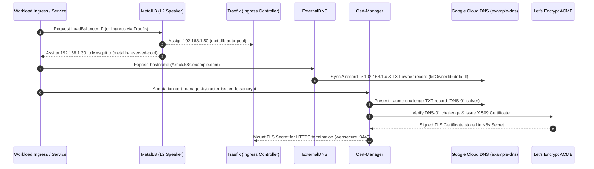
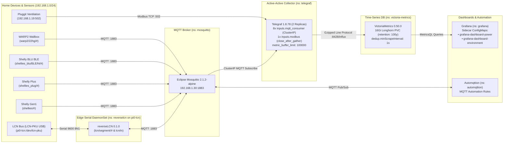

# Sloth System Architecture

This document illustrates the GitOps application hierarchy, network/ingress flow, distributed block storage topology, and smarthome telemetry pipeline of the `sloth` cluster.

---

## 1. Argo CD App-of-Apps Hierarchy

`sloth` uses a 3-tier Argo CD **App-of-Apps** structure rooted in [`argocd-base/`](../argocd-base/), paired with a companion private repository (`sloth-private`, documented in [`PRIVATE_OVERLAY.md`](./PRIVATE_OVERLAY.md)) for domain overlays, `SealedSecret` manifests, and private-only applications. Every `Application` reconciles against `HEAD` of `https://github.com/MyChaOS87/sloth.git` (and/or `git@github.com:MyChaOS87/sloth-private.git`) with automated `syncPolicy` (`prune: true`, `selfHeal: true`).

```mermaid
flowchart TD
    subgraph Tier0["Tier 0: Bootstrap (argocd-base/)"]
        ArgoCD["argocd (argo-cd 10.14.0 + $private)<br/>ns: argocd"]
        Nodes["nodes (ServerSideApply)<br/>path: nodes/ | proj: nodes"]
        RootEssentials["argocd-cluster-essentials<br/>path: cluster-essentials/"]
        RootDeployments["argocd-deployments<br/>path: deployments/"]
        RootPrivate["private (from sloth-private)<br/>path: private/ | proj: private"]
    end

    subgraph Tier1["Tier 1: Cluster Essentials (cluster-essentials/)"]
        SealedSecrets["sealed-secrets (2.22.0)<br/>ns: sealed-secrets"]
        KubeVIP["kube-vip (0.11.2)<br/>ns: kube-system | VIP: 192.168.1.20"]
        MetalLB["metallb (0.16.2) + metallb-config<br/>ns: metallb"]
        Traefik["traefik (42.3.1) + dashboard<br/>ns: traefik"]
        CertManager["cert-manager (v1.21.3) + cluster-issuer<br/>ns: cert-manager"]
        ExternalDNS["external-dns (1.23.0) + external-dns-config<br/>ns: external-dns"]
        Longhorn["longhorn (1.13.0) + storage-nodes<br/>ns: longhorn"]
        SysUpgrade["system-upgrade (v0.21.0)<br/>ns: system-upgrade"]
        KairosOp["kairos-operator (0.3.0) + kairos-operator-config<br/>ns: kairos-operator"]
        Prometheus["prometheus (29.41.0)<br/>ns: prometheus"]
        VersionChecker["version-checker (v0.11.0)<br/>ns: version-checker"]
    end

    subgraph Tier2["Tier 2: Workload Projects (deployments/)"]
        AppOIDC["oidc<br/>path: deployments/oidc/"]
        AppSmarthome["smarthome<br/>path: deployments/smarthome/"]
    end

    subgraph Tier3_OIDC["OIDC Stack (deployments/oidc/)"]
        Authelia["authelia (0.11.22 / 4.39.28)<br/>ns: oidc"]
    end

    subgraph Tier3_SH["Smarthome Stack (deployments/smarthome/)"]
        Mosquitto["mosquitto (local chart 2.1.3)<br/>ns: mosquitto"]
        Telegraf["telegraf (1.8.78, 2 replicas)<br/>ns: telegraf"]
        VictoriaMetrics["victoria-metrics (0.50.0)<br/>ns: victoria-metrics"]
        Grafana["grafana (10.5.15) + dashboards<br/>ns: grafana"]
        Automqttion["automqttion (0.1.0)<br/>ns: automqttion"]
        ReverseLCN["reverselcn (0.1.0)<br/>ns: reverselcn"]
    end

    RootEssentials --> SealedSecrets
    RootEssentials --> KubeVIP
    RootEssentials --> MetalLB
    RootEssentials --> Traefik
    RootEssentials --> CertManager
    RootEssentials --> ExternalDNS
    RootEssentials --> Longhorn
    RootEssentials --> SysUpgrade
    RootEssentials --> KairosOp
    RootEssentials --> Prometheus
    RootEssentials --> VersionChecker

    RootDeployments --> AppOIDC
    RootDeployments --> AppSmarthome
    AppOIDC --> Authelia
    AppSmarthome --> Mosquitto
    AppSmarthome --> Telegraf
    AppSmarthome --> VictoriaMetrics
    AppSmarthome --> Grafana
    AppSmarthome --> Automqttion
    AppSmarthome --> ReverseLCN
```

### AppProject Isolation Boundaries

| `AppProject` | Manifest | Permitted Source Repos | Target Namespaces |
|--------------|----------|------------------------|-------------------|
| `argocd-base` | [`argocd-base/argocd-base.yaml`](../argocd-base/argocd-base.yaml) | `https://github.com/MyChaOS87/sloth.git`, `git@github.com:MyChaOS87/sloth-private.git`, `https://argoproj.github.io/argo-helm` | `argocd` (+ cluster `Namespace`, `CRD`, `ClusterRole`, `ClusterRoleBinding`) |
| `nodes` | [`argocd-base/nodes.yaml`](../argocd-base/nodes.yaml) | `https://github.com/MyChaOS87/sloth.git` | Cluster-scoped `v1/Node` only (`namespaceResourceBlacklist: */*`, no orphan watch) |
| `cluster-essentials` | [`cluster-essentials/cluster-essentials.yaml`](../cluster-essentials/cluster-essentials.yaml) | `*` | `*` (cluster-wide infrastructure & CRDs) |
| `oidc` | [`deployments/oidc/oidc.yaml`](../deployments/oidc/oidc.yaml) | `https://charts.authelia.com`, `git@github.com:MyChaOS87/sloth-private.git` | `oidc` (`authelia`, no cluster-scoped resources) |
| `smarthome` | [`deployments/smarthome/smarthome.yaml`](../deployments/smarthome/smarthome.yaml) | `sloth`, `sloth-private`, `grafana`, `influxdata`, `victoriametrics`, `automqttion`, `reverseLCN` | `grafana`, `victoria-metrics`, `mosquitto`, `telegraf`, `automqttion`, `reverselcn` (+ `ClusterRole`, `ClusterRoleBinding` for Grafana sidecar) |
| `private` | `sloth-private/private/private.yaml` | `*` | `*` (private workloads & experiments isolated from `sloth`) |

---

## 2. Networking, Ingress, DNS & TLS Architecture

Because K3s runs with `--disable traefik --disable servicelb`, Layer-2 IP allocation, ingress routing, public DNS records, and Let's Encrypt TLS certificates are orchestrated through four collaborating components (example endpoints below shown using `example.com` and `example-dns`):

### Exposed Endpoints Summary (Shown with `example.com`)

| Service | Hostname / IP | Exposure Mechanism | TLS / Auth |
|---------|---------------|--------------------|------------|
| **K3s Control-Plane API** | `192.168.1.20:6443` (`api.internal.k8s.example.com`, `api.rock.k8s.example.com`) | `kube-vip` L2 ARP Leader Lease (`plndr-cp-lock` on `enP4p65s0`) + `ExternalName` DNS Service (`sloth-private`) | K3s Cluster CA TLS (`:6443`) |
| **Argo CD UI/API** | `argocd.internal.k8s.example.com`, `argocd.rock.k8s.example.com` | Traefik `Ingress` | Let's Encrypt TLS + Authelia OIDC |
| **Traefik Dashboard** | Cluster-internal port-forward | Traefik `IngressRoute` | HTTP / Internal LAN |
| **Longhorn UI** | `longhorn.rock.k8s.example.com` | Traefik `Ingress` | Let's Encrypt TLS + Authelia ForwardAuth |
| **Prometheus UI** | `prometheus.internal.k8s.example.com`, `prometheus.rock.k8s.example.com` | Traefik `Ingress` | Let's Encrypt TLS + Authelia ForwardAuth |
| **Authelia SSO** | `sso.internal.k8s.example.com`, `sso.rock.k8s.example.com` | Traefik `Ingress` | Let's Encrypt TLS (Passkey / WebAuthn + Argon2id) |
| **Grafana** | `grafana.rock.k8s.example.com`, `grafana.internal.k8s.example.com` | Traefik `Ingress` | Let's Encrypt TLS + Authelia OIDC |
| **VictoriaMetrics UI/API** | `victoria.rock.k8s.example.com`, `victoria.internal.k8s.example.com` | Traefik `Ingress` | Let's Encrypt TLS + Authelia ForwardAuth |
| **Mosquitto MQTT** | `192.168.1.30:1883` (`mosquitto.rock.k8s.example.com`, `mosquitto.internal.k8s.example.com`) | MetalLB `LoadBalancer` (`metallb-reserved-pool`) | TCP `:1883` |

### Network & Ingress Trust Boundaries

* **LAN-Local MQTT (`192.168.1.30:1883`)**: Mosquitto runs unauthenticated (`allow_anonymous true`) on the isolated RFC 1918 residential LAN (`192.168.1.0/24`, never port-forwarded to the public internet) so embedded Shelly, WARP2, and `reverseLCN` clients publish directly without credential management overhead; the container runtime itself runs unprivileged (`UID/GID 1883`, `readOnlyRootFilesystem: true`, `capabilities.drop: ["ALL"]`, `automountServiceAccountToken: false`).
* **Traefik Cross-Namespace CRD References (`allowCrossNamespace: true`)**: Enabled intentionally in [`cluster-essentials/traefik.yaml`](../cluster-essentials/traefik.yaml) so `Ingress` resources across `longhorn`, `prometheus`, and `victoria-metrics` can reference the centralized `oidc-chain-authelia-auth@kubernetescrd` ForwardAuth `Middleware` deployed in namespace `oidc`.

---

## 3. Declarative Node Roles & Rolling Upgrade Architecture

`sloth` separates node capabilities into explicit single-purpose roles managed via Server-Side Apply ([`argocd-base/nodes.yaml`](../argocd-base/nodes.yaml), `AppProject: nodes`, `sync-wave: "-1"`, `Prune=false,Delete=false`):

| Role Label | Assigned Nodes | Consuming DaemonSet / Component | Taint Handling |
|------------|----------------|---------------------------------|----------------|
| `node-role.kubernetes.io/storage: "true"` | `rock5b-but`, `rock5b-first`, `rock5b-coffee` | [`longhorn`](../cluster-essentials/longhorn.yaml) (`longhornManager`, `longhornDriver`) | Untainted control-plane/storage nodes |
| `node-role.kubernetes.io/speaker: "true"` | `rock5b-but`, `rock5b-first`, `rock5b-coffee` | [`metallb`](../cluster-essentials/metallb.yaml) (`speaker.nodeSelector`) | Untainted wired LAN nodes |
| `node-role.kubernetes.io/monitoring: "true"` | `rock5b-but`, `rock5b-first`, `rock5b-coffee`, `pi0-lcn` | [`prometheus`](../cluster-essentials/prometheus.yaml) (`prometheus-node-exporter.nodeSelector`) | Tolerates `effect: NoSchedule` and `key: dedicated` (`operator: Exists`) |
| `node-role.kubernetes.io/lcn-serial: "true"` | `pi0-lcn` (tainted `dedicated=lcn-serial:NoExecute`) | [`reverselcn`](../deployments/smarthome/reverselcn.yaml) (`DaemonSet`, `maxSurge: 0`, `maxUnavailable: 1`) | Tolerates `dedicated=lcn-serial:NoExecute` |

- **Two-Phase `v1/Node` Registration**:
  - Applying a `v1/Node` manifest via `ServerSideApply=true` before a physical node has joined creates a bare `NotReady` node in Kubernetes and bypasses kubelet's initial cloud-provider registration taint. Only nodes that have already joined the cluster are declared in [`nodes/`](../nodes/), and each `v1/Node` manifest carries `argocd.argoproj.io/sync-options: Prune=false,Delete=false` so even a cascade delete of the `nodes` Application can never delete a live node.
- **Rolling K3s & Immutable Kairos Upgrades ([`cluster-essentials/system-upgrade-config/`](../cluster-essentials/system-upgrade-config/) & [`cluster-essentials/kairos-operator-config/`](../cluster-essentials/kairos-operator-config/))**:
  - [`kairos-os.yaml`](../cluster-essentials/kairos-operator-config/kairos-os.yaml): `NodeOpUpgrade` (`kairos-operator`) performs rolling A/B OCI image upgrades (`concurrency: 1`, `stopOnFailure: true`) on nodes labeled `kairos.io/managed: "true"`.
  - [`k3s.yaml`](../cluster-essentials/system-upgrade-config/k3s.yaml): `agent-plan` upgrades non-Kairos agent nodes (`kairos.io/managed: DoesNotExist`, such as `pi0-lcn`) to the pinned K3s version (`v1.37.2+k3s1`, parity-checked against `kairos-os.yaml` by [`policy/upgrades.rego`](../policy/upgrades.rego)).

---

## 4. Distributed Block Storage Architecture (Longhorn)

Longhorn (`v1.13.0`) provides replicated block storage across the 3 NVMe-backed Rock5B nodes:

- **Declarative Node Configuration**:
  - [`nodes/`](../nodes/) assigns `node-role.kubernetes.io/storage: "true"` to the 3 Rock5B nodes via Server-Side Apply, and [`cluster-essentials/longhorn.yaml`](../cluster-essentials/longhorn.yaml) restricts `longhornManager` and `longhornDriver` to `node-role.kubernetes.io/storage: "true"`.
  - [`cluster-essentials/longhorn-config/`](../cluster-essentials/longhorn-config/) defines `nodes.longhorn.io/v1beta2` CRDs for [`rock5b-but.yaml`](../cluster-essentials/longhorn-config/rock5b-but.yaml), [`rock5b-first.yaml`](../cluster-essentials/longhorn-config/rock5b-first.yaml), and [`rock5b-coffee.yaml`](../cluster-essentials/longhorn-config/rock5b-coffee.yaml), plus [`filesystem-trim.yaml`](../cluster-essentials/longhorn-config/filesystem-trim.yaml) (`recurringjobs.longhorn.io/v1beta2` weekly `filesystem-trim` job in group `default`, paired with `defaultSettings.removeSnapshotsDuringFilesystemTrim: true`).
- **Disk Layout**:
  - `disk-0`: Located at `/var/lib/longhorn/disk0/` on each node's `COS_PERSISTENT` (`ext4` `/dev/nvme0n1p5`) NVMe partition (`allowScheduling: true`, `storageReserved: 53687091200` = 50 GiB reserved for OS/K3s, with each node's `diskUUID` preserved via `longhorn-disk.cfg`).
- **Persistent Volume Consumers**:
  1. **VictoriaMetrics (`victoria-metrics`)**: 16 GiB PVC (`storageClassName: longhorn`, `retentionPeriod: 100y`) storing columnar time-series blocks in `victoria-metrics`.
  2. **Prometheus (`prometheus-server` & `storage-prometheus-alertmanager-0`)**: 100 GiB + 2 GiB Longhorn PVCs storing cluster metrics and alert state in `prometheus`.
  3. **Authelia (`authelia`)**: 1 GiB PVC (`storageClassName: longhorn`) storing SQLite state (`/config/db.sqlite3`: WebAuthn credentials, TOTP secrets, OIDC consent sessions) in `oidc`.
  *(Note: **Grafana (`grafana`)** intentionally runs statelessly on `emptyDir` rather than a Longhorn PVC because all dashboards, datasources, and OIDC RBAC roles are reconciled declaratively via GitOps and Authelia SSO, preserving zero-downtime `RollingUpdate` scheduling without `ReadWriteOnce` volume locks.)*

---

## 5. Smarthome Telemetry Pipeline

### Telegraf Measurement Schema

| Measurement(s) | Input Plugin & Topic / Endpoint | Key Tags | Key Fields |
|----------------|---------------------------------|----------|------------|
| `power`, `energy`, `voltage`, `current`, `temperature`, `humidity`, `battery` | `inputs.mqtt_consumer` (`shellies/+/+/+/{power,energy,voltage,current}`, `shellies/+/sensor/{temperature,humidity,battery}`) | `shelly_id`, `shelly_type`, `sub_id` | `value` (float) |
| `power` | `inputs.mqtt_consumer` (`warp2/22hg/meter/values`, `warp2/22hg/meters/0/values`) | `wallbox_name`, `meter_id` | `power`, `l1..l3_voltage`, `l1..l3_current`, `l1..l3_power`, `l1..l3_apparent_power`, `total_power`, `total_apparent_power`, `frequency` |
| `power`, `voltage`, `current`, `frequency`, `energy`, `temperature` | `inputs.mqtt_consumer` (`shellies_plug/+/status/switch:0`) | `shelly_id`, `shelly_type=relay` | `value` (from `apower`, `voltage`, `current`, `freq`, `aenergy.total`, `temperature.tC`) |
| `temperature`, `humidity` | `inputs.mqtt_consumer` (`shellies_plus/+/status/{temperature,humidity}:0`) | `shelly_id` | `value` (from `tC`, `rh`) |
| `em:0` | `inputs.mqtt_consumer` (`shellies_pro/+/status/em:0`) | `shelly_id` | `a/b/c_{current,voltage,act_power,aprt_power,pf,freq}`, `n_current`, `total_{current,act_power,aprt_power}` |
| `temperature`, `humidity`, `battery` | `inputs.mqtt_consumer` (`shellies_blu/BLE/ht/+`) | `shelly_id` | `value` (float) |
| `pluggit_modbus` | `inputs.modbus` (`tcp://192.168.1.19:502`, `slave_id = 1`) | `name`, `type`, `slave_id` | `CurrentBLState`, `RamIdxT1..T4` (°C), `RomIdxSpeedLevel`, `HALTaho1..2` (RPM), `RamIdxBypassActualState`, `VOC` |
